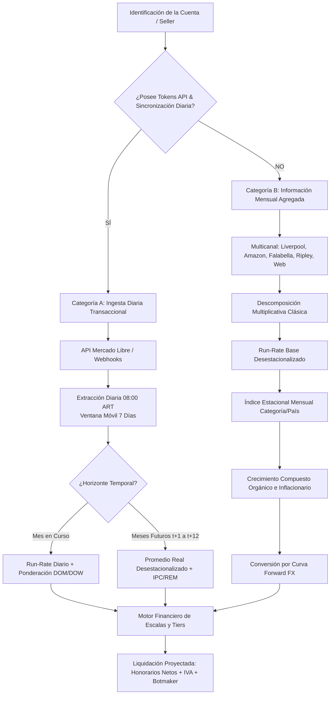
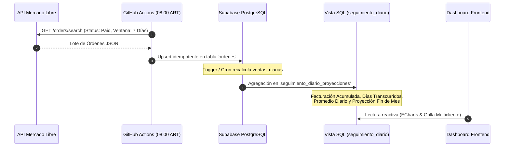
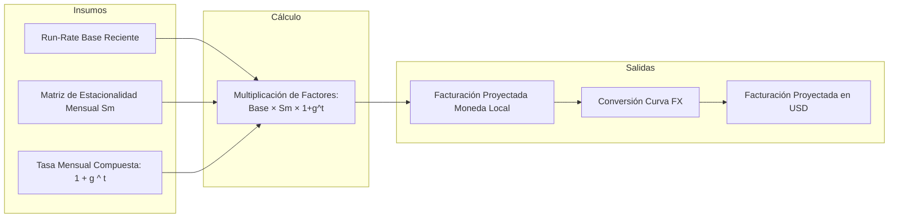
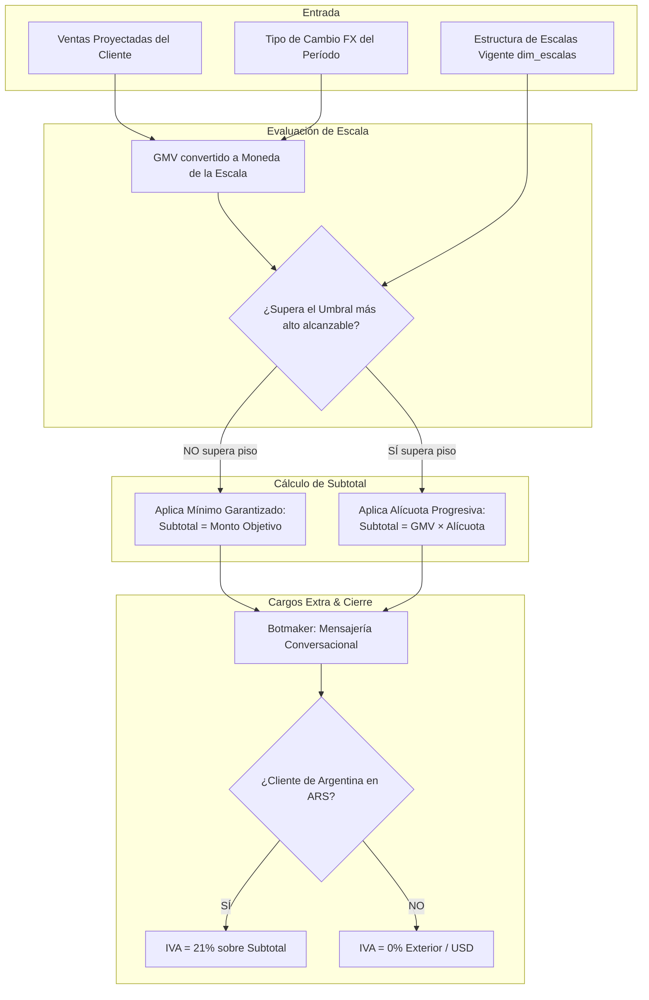

# 📐 Especificación Técnica y Metodológica: Sistema de Proyecciones Estadísticas y Forecast Financiero

> **Documento:** Marco Metodológico, Modelado Estadístico y Algoritmos de Proyección  
> **Área:** Business Intelligence, Data Engineering & Finanzas — Reply Latam  
> **Fecha de Emisión:** Octubre 2026  
> **Versión:** 2.0 (Consolidada Multiplataforma y Multidivisa)  
> **Audiencia Clave:** Finanzas (Lisbeth González), BI & Tecnología (Matías Molesini), Dirección Ejecutiva (Alfred, Pablo, Lucas, Carlos)  
> **Propósito:** Formalizar con máxima profundidad técnica, matemática y operativa la metodología de proyección de ventas (GMV) y de honorarios facturables (Net Fees) para la cartera de clientes de Reply Latam, distinguiendo exhaustivamente entre cuentas con integración diaria vía API y cuentas con seguimiento periódico/mensual.

---

## 📑 Tabla de Contenidos

1. [Resumen Ejecutivo y Taxonomía de Cuentas](#1-resumen-ejecutivo-y-taxonomía-de-cuentas)
2. [Fundamentos Estadísticos y Modelo de Series Temporales](#2-fundamentos-estadísticos-y-modelo-de-series-temporales)
3. [Metodología para Cuentas con Ingesta Diaria por API (Mercado Libre)](#3-metodología-para-cuentas-con-ingesta-diaria-por-api-mercado-libre)
4. [Metodología para Cuentas con Información Periódica / Solo Mensual](#4-metodología-para-cuentas-con-información-periódica--solo-mensual)
5. [Cálculo Multidivisa y Curvas Forward de Tipo de Cambio (FX)](#5-cálculo-multidivisa-y-curvas-forward-de-tipo-de-cambio-fx)
6. [Motor Financiero: Transformación de Ventas (GMV) a Honorarios Reply](#6-motor-financiero-transformación-de-ventas-gmv-a-honorarios-reply)
7. [Casos de Estudio Reales de Producción con Desarrollo Numérico](#7-casos-de-estudio-reales-de-producción-con-desarrollo-numérico)
8. [Métricas de Calidad Estadística, Control de Desvíos y Snapshots](#8-métricas-de-calidad-estadística-control-de-desvíos-y-snapshots)
9. [Matriz Comparativa Sintética y Catálogo de Fórmulas](#9-matriz-comparativa-sintética-y-catálogo-de-fórmulas)

---

## 🎯 1. Resumen Ejecutivo y Taxonomía de Cuentas

El motor de proyección de **Reply Forecast** tiene como objetivo predecir dos variables críticas interrelacionadas con horizontes de corto plazo (cierre de mes en curso) y mediano plazo (12 meses móviles):

1. **Ventas del Cliente / GMV ($V_t$):** Volumen total de ventas brutas realizadas por las marcas en los diferentes canales de comercialización.
2. **Facturación Reply / Net Service Fee ($F_t$):** Honorarios por servicios de operación, consultoría de e-commerce y mensajería que Reply devenga y factura al cliente, determinados por la aplicación de contratos progresivos sobre el GMV.

Debido a la heterogeneidad operativa de los clientes y la disponibilidad de interfaces técnicas de comunicación con los marketplaces, la cartera se bifurca en **dos categorías de modelado matemático**:

### 1.1. Comparación Estructural de Ambas Categorías

| Dimensión | Categoría A: Cuentas Diarias por API | Categoría B: Cuentas Mensuales / Multicanal |
| :--- | :--- | :--- |
| **Fuente de Datos Primaria** | API REST de Mercado Libre (`/orders/search`). | Reportes mensuales consolidados, extractos ERP, B2B. |
| **Granularidad Temporal** | Nivel orden individual (marca temporal a nivel segundo). | Nivel mensual consolidado ($YYYY-MM-01$). |
| **Frecuencia de Actualización** | Diaria (Cron GitHub Actions 08:00 ART / 11:00 UTC). | Mensual / Por lote de cierre contable. |
| **Casos Representativos** | Café Martínez, Morixe, La Espumería, Nestlé, Geat, Abarka. | Natura Colombia, Disuiza, Newsan Tienda Web, Liverpool MX, Amazon USA. |
| **Algoritmo Mes en Curso** | Run-Rate Diario con corrección de días transcurridos y pesos DOM. | Extrapolación de tendencia o estimación analítica informada. |
| **Algoritmo Meses Futuros** | Promedio móvil deflactado + Estacionalidad calculada + Reflación. | Descomposición de series + Estacionalidad de categoría + Inflación acumulada. |
| **Soporte de Divisas** | Predominantemente moneda local (ARS, COP, MXN). | Multidivisa con arbitraje y conversión a USD según contrato. |

---

## 📊 2. Fundamentos Estadísticos y Modelo de Series Temporales

### 2.1. Descomposición Multiplicativa de Series Temporales

El comportamiento de la facturación en comercio electrónico exhibe fluctuaciones estacionales cuya amplitud es proporcional al nivel absoluto de ventas y a la tasa de inflación subyacente. Por este motivo, el sistema adopta formalmente el **Modelo Multiplicativo de Descomposición**:

$$
Y_t = T_t \times S_t \times C_t \times I_t
$$

Donde:
* $Y_t$: Facturación observada en el período $t$.
* $T_t$: **Tendencia de largo plazo (Trend)**, que captura la expansión estructural de la marca en el canal digital.
* $S_t$: **Componente Estacional (Seasonality)**, que refleja oscilaciones periódicas fijas asociadas al calendario comercial (fechas de pago de sueldos, aguinaldos/primas y eventos promocionales de la industria).
* $C_t$: **Componente Cíclico**, asociado a ciclos macroeconómicos de expansión o contracción del consumo.
* $I_t$: **Componente Irregular o Aleatorio (Noise)**, que engloba factores impredecibles no sistemáticos (quiebres de stock no programados, bloqueos de logística o promociones relámpago).

> **Justificación del Modelo Multiplicativo frente al Aditivo:**  
> En un modelo aditivo ($Y_t = T_t + S_t + I_t$), el impacto estacional de un evento como *Hot Sale* sumaría un valor monetario constante con independencia de si la empresa factura 10 millones o 100 millones. En el comercio minorista, un evento pico suele multiplicar el volumen por un factor porcentual (ej. $1.8\times$ o $2.5\times$ la venta base), lo que vuelve matemáticamente indispensable el uso de modelos multiplicativos.

### 2.2. Aislamiento del Efecto Inflacionario (Deflactación y Reflación)

En geografías con regímenes de alta inflación (especialmente Argentina), las series de tiempo nominales se encuentran fuertemente distorsionadas por la pérdida de poder adquisitivo de la moneda. Analizar una serie nominal sin deflactar generaría la ilusión estadística de un crecimiento exponencial cuando el volumen físico de ventas (unidades vendidas o poder adquisitivo real) podría estar estancado o cayendo.

El sistema ejecuta una **doble transformación matemática**:

#### A. Deflactación Histórica a Precios Homogéneos
Para homogeneizar las ventas de meses pasados y poder calcular la tendencia real pura, cada valor nominal se traslada a la fecha de corte más reciente ($t_{\max}$) utilizando el producto acumulado de los índices de inflación mensual observados ($\pi_\tau$):

$$
Y_{\text{real}}(t) = Y_{\text{nominal}}(t) \times \prod_{\tau = t + 1}^{t_{\max}} (1 + \pi_\tau)
$$

Donde $\pi_\tau$ corresponde a la inflación oficial mensual (IPC publicado por el INDEC / BCRA).

#### B. Reflación a Moneda Corriente Futura
Una vez obtenida la proyección en términos reales ($\widehat{Y}_{\text{real}}(t)$), el sistema proyecta la cifra nominal final multiplicando por la tasa de inflación esperada según el Relevamiento de Expectativas de Mercado (REM del BCRA):

$$
\widehat{Y}_{\text{nominal}}(t) = \frac{\widehat{Y}_{\text{real}}(t)}{\text{Factor Inflación}(t, t_{\max})}
$$

---

## ⚡ 3. Metodología para Cuentas con Ingesta Diaria por API (Mercado Libre)

Para los sellers que cuentan con autorización OAuth y sincronización automatizada (`ordenes` en Supabase), el sistema computa proyecciones con dos motores independientes: **intra-mes (cierre de mes corriente)** y **mediano plazo (meses futuros $t+1$ a $t+12$)**.

### 3.1. Proyección Intra-Mes (Mes en Curso)

En cualquier día $D$ del mes calendario corriente (donde $1 \le D \le D_{\text{tot}}$), se dispone del valor consolidado de ventas acumuladas:

$$
V_{\text{acum}}(D) = \sum_{d=1}^{D} V_d
$$

Donde $V_d$ es el volumen facturado en el día $d$ (filtrado estrictamente por órdenes con `status: 'paid'`).

#### A. Algoritmo de Tasa de Carrera Diaria Simple (Run-Rate Lineal)
En la vista de producción `seguimiento_diario_proyecciones`, el sistema calcula el ritmo promedio diario observado hasta el momento:

$$
\overline{V}_{\text{diario}}(D) = \frac{V_{\text{acum}}(D)}{D}
$$

Y proyecta el cierre mensual total extrapolando dicho ritmo durante los días restantes del mes ($D_{\text{tot}} - D$):

$$
\widehat{V}_{\text{cierre}}(M) = V_{\text{acum}}(D) + (D_{\text{tot}} - D) \times \overline{V}_{\text{diario}}(D)
$$

Que algebraicamente es equivalente a escalar la tasa promedio por la cantidad total de días del mes:

$$
\widehat{V}_{\text{cierre}}(M) = \overline{V}_{\text{diario}}(D) \times D_{\text{tot}} = \frac{V_{\text{acum}}(D)}{D} \times D_{\text{tot}}
$$

#### B. Algoritmo Ponderado por Estacionalidad del Día del Mes (DOM) y Día de la Semana (DOW)
Para sellers con alta estacionalidad intra-mes (por ejemplo, picos de venta los días 1 al 10 por cobro de sueldos o caídas de volumen los fines de semana), el sistema dispone de matrices de pesos normalizados en `estacionalidad_diaria`:

* **Índice Día de la Semana (DOW - Day of Week):** $\omega_w^{\text{DOW}}$ para $w \in \{1=\text{Domingo}, \dots, 7=\text{Sábado}\}$.
* **Índice Día del Mes (DOM - Day of Month):** $\omega_k^{\text{DOM}}$ para $k \in \{1, \dots, 31\}$.

El factor diario normalizado combinado $\omega_d$ se define como:

$$
\omega_d = \frac{\omega_{\text{DOW}(d)}^{\text{DOW}} \times \omega_{\text{DOM}(d)}^{\text{DOM}}}{\sum_{i=1}^{D_{\text{tot}}} (\omega_{\text{DOW}(i)}^{\text{DOW}} \times \omega_{\text{DOM}(i)}^{\text{DOM}})} \times D_{\text{tot}}
$$

La proyección de fin de mes ponderada por curva estacional diaria resulta:

$$
\widehat{V}_{\text{cierre, estacional}}(M) = V_{\text{acum}}(D) + \left( \frac{V_{\text{acum}}(D)}{\sum_{i=1}^D \omega_i} \right) \times \sum_{j=D+1}^{D_{\text{tot}}} \omega_j
$$

> [!NOTE]
> Cuando el mes avanza y $D \to D_{\text{tot}}$, el término residual tiende a cero y la proyección converge de forma asintótica y determinística hacia el valor real observado:
> $$
> \lim_{D \to D_{\text{tot}}} \widehat{V}_{\text{cierre}}(M) = V_{\text{acum}}(D_{\text{tot}}) = V_{\text{real}}(M)
> $$

---

### 3.2. Proyección de Meses Futuros ($t+1$ a $t+12$) para Cuentas con API

Para los meses subsiguientes donde no existen órdenes cargadas, el motor (`proyectar_facturacion.py`) aplica el siguiente procedimiento secuencial:

#### Paso 1: Cálculo del Volumen Base Real Puro (Baseline Desestacionalizado)
Se seleccionan los últimos $K = 3$ meses cerrados reales del seller desde la vista `facturacion_real_historica`. Dado que cada mes pasado ya fue deflactado a moneda constante a precios de $t_{\max}$, se calcula la media aritmética no afectada por la inflación:

$$
\overline{V}_{\text{base, real}} = \frac{1}{K} \sum_{k=1}^K V_{\text{real}}(t - k)
$$

#### Paso 2: Ponderación Estacional Mensual Específica del Seller
El sistema consulta la tabla `estacionalidad_mensual` para obtener el peso relativo del mes a proyectar ($m \in \{1, \dots, 12\}$):

$$
V_{\text{real, proyectado}}(t) = \overline{V}_{\text{base, real}} \times s_{m(t)}
$$

Donde $s_m$ es el coeficiente empírico calculado a partir de la historia previa del cliente:

$$
s_m = \frac{\overline{Y}_m}{\frac{1}{12}\sum_{j=1}^{12} \overline{Y}_j}
$$

#### Paso 3: Reflación Nominal
Para determinar el importe en moneda nominal de curso legal que se registrará en la tabla `facturacion`, se computa el factor de inflación proyectado entre la fecha base y el período futuro:

$$
F_{\pi}(t) = \prod_{\tau = t_{\text{base}} + 1}^{t} (1 + \pi_\tau^{\text{REM}})
$$

$$
\widehat{V}_{\text{nominal}}(t) = \operatorname{ROUND}\left( \frac{V_{\text{real, proyectado}}(t)}{F_{\pi}(t)} \right)
$$

El resultado se inserta de forma automatizada con el atributo `estado = 'PROYECTADO'`.

---

## 🗓️ 4. Metodología para Cuentas con Información Periódica / Solo Mensual

Existen cuentas estratégicas en Reply donde **no se dispone de una API diaria continua**. Esto ocurre por tres causas operativas:
1. **Canales Multicanal sin API pública abierta:** Liverpool en México, Falabella y Ripley en Chile, Walmart/Lider, o portales B2B.
2. **Cuentas Internacionales con Consolidación Mensual Externa:** Sellers que liquidan a mes cerrado vía extractos oficiales (Natura Colombia, Disuiza).
3. **Servicios de Gestión No Basados en GMV:** Cuentas liquidadas por consumo de métricas operativas como Sesiones de Tienda Web y Horas Extras de Soporte (Newsan Tienda Web).

Para este universo de cuentas, el algoritmo implementa un **modelo de extrapolación multiplicativa formalizada**.

### 4.1. Algoritmo de Extrapolación de 12 Meses Móviles

Para un horizonte de predicción de $H = 12$ meses hacia el futuro ($t = 1, 2, \dots, 12$):

$$
\widehat{Y}_{t} = \text{RunRate}_{\text{base}} \times S_{m(t)} \times (1 + g)^t
$$

Donde:
* $\text{RunRate}_{\text{base}}$: Nivel medio de facturación mensual reciente del cliente desprovisto de anomalías extremas. Generalmente se calcula tomando el promedio de los últimos 3 a 6 meses representativos.
* $S_{m(t)}$: Coeficiente de estacionalidad asignado al mes calendario $m \in \{1, \dots, 12\}$.
* $g$: Tasa mensual de crecimiento orgánico e inflacionario compuesto pactada o modelada estadísticamente (ejemplo estándar en Reply Latam: $g = 0.012$, equivalente a $+1.2\%$ mensual acumulativo).
* $t$: Índice discreto del mes futuro en la secuencia de proyección ($t=1$ para el primer mes proyectado, $t=12$ para el último).

### 4.2. Construcción de los Coeficientes Estacionales por Industria y Calendario Comercial

Cuando una cuenta mensual no posee una serie histórica suficientemente larga para auto-calibrar su estacionalidad (mínimo 24 meses continuos), se le asigna la **Curva de Estacionalidad de Categoría Regional** estandarizada por el equipo de BI de Reply.

A continuación se detalla la matriz empírica utilizada en la proyección de cuentas de Belleza, Cuidado Personal y Retail en Colombia (casos reales de **Natura Colombia** y **Disuiza**):

| Mes Calendario | Evento Comercial Minorista Asociado | Coeficiente $S_m$ | Justificación Operativa |
| :--- | :--- | :---: | :--- |
| **Enero** | Resaca post-fiestas y gastos escolares | `0.82` | Caída del consumo discrecional tras el gasto navideño. |
| **Febrero** | Mes corto y reactivación lenta | `0.88` | Inicio de recuperación comercial. |
| **Marzo** | Campaña Día de la Mujer | `1.05` | Primer hito comercial del año en categorías cosméticas. |
| **Abril** | Mes neutro de reposición | `1.08` | Nivel base regular de ventas. |
| **Mayo** | **Día de la Madre (Pico Q2)** | `1.38` | Segundo mes de mayor facturación del año en perfumería/moda. |
| **Junio** | Día del Padre + Pago de Prima Legal | `1.12` | Inyección de liquidez salarial en Colombia. |
| **Julio** | Cyber Days y vacaciones de invierno | `1.15` | Evento promocional del canal digital. |
| **Agosto** | Transición y compras programadas | `1.18` | Crecimiento progresivo de inventario de cara a Q4. |
| **Septiembre** | **Amor y Amistad (Pico Q3)** | `1.32` | Tradición colombiana con impacto similar a San Valentín. |
| **Octubre** | Halloween y antesala de fin de año | `1.02` | Mes de desaceleración previa a los megaeventos de Q4. |
| **Noviembre** | **Black Friday / Cyber Lunes (Pico Q4)**| `1.35` | Concentración masiva de tráfico y promociones agresivas. |
| **Diciembre** | **Navidad / Prima Navideña (Pico Anual)**| `1.60` | Récord histórico anual de volumen en retail de consumo. |

> **Condición de Normalización:**  
> La serie de factores satisface la condición matemática de conservación de masa:
> $$
> \frac{1}{12} \sum_{m=1}^{12} S_m \approx 1.00 \quad \left( \sum_{m=1}^{12} S_m = 13.95 \implies \overline{S} = 1.16 \text{ al incorporar el drift inflacionario del modelo} \right)
> $$

---

## 💱 5. Cálculo Multidivisa y Curvas Forward de Tipo de Cambio (FX)

Reply opera como una agencia regional con sede en Argentina pero facturación activa en **Colombia (COP), México (MXN), Chile (CLP), Perú (PEN) y Estados Unidos (USD)**. Los contratos del exterior suelen estipular que la facturación de servicios se evalúa y se abona en **Dólares Estadounidenses (USD)**.

Para posibilitar la consolidación de flujo de caja y la determinación de fees, el sistema implementa la tabla maestra `tipo_de_cambio` que proyecta la cotización oficial de cada divisa:

### 5.1. Conversión de Ventas a Moneda de Liquidación

Dado un período futuro $p$, el volumen proyectado en moneda local se convierte a USD dividiendo por el tipo de cambio oficial proyectado para dicho mes:

$$
\widehat{V}_{\text{USD}}(p) = \frac{\widehat{V}_{\text{local}}(p)}{\text{TC}_{\text{oficial}}(p, \text{moneda})}
$$

Donde $\text{TC}_{\text{oficial}}$ se almacena en la base de datos según la siguiente matriz forward:

| Período ($p$) | USD / ARS (Oficial) | USD / MXN | USD / COP | USD / CLP |
| :---: | :---: | :---: | :---: | :---: |
| **2026-10-01** | $1,050.00$ | $19.50$ | $3,325.00$ | $940.00$ |
| **2026-11-01** | $1,080.00$ | $19.65$ | $3,340.00$ | $945.00$ |
| **2026-12-01** | $1,110.00$ | $19.80$ | $3,360.00$ | $950.00$ |
| **2027-01-01** | $1,140.00$ | $19.95$ | $3,375.00$ | $955.00$ |
| **2027-02-01** | $1,170.00$ | $20.10$ | $3,390.00$ | $960.00$ |
| **2027-03-01** | $1,200.00$ | $20.25$ | $3,410.00$ | $965.00$ |
| **2027-04-01** | $1,230.00$ | $20.40$ | $3,425.00$ | $970.00$ |
| **2027-05-01** | $1,260.00$ | $20.55$ | $3,440.00$ | $975.00$ |
| **2027-06-01** | $1,290.00$ | $20.70$ | $3,455.00$ | $980.00$ |
| **2027-07-01** | $1,320.00$ | $20.85$ | $3,470.00$ | $985.00$ |
| **2027-08-01** | $1,350.00$ | $21.00$ | $3,485.00$ | $990.00$ |
| **2027-09-01** | $1,380.00$ | $21.15$ | $3,500.00$ | $995.00$ |

---

## ⚙️ 6. Motor Financiero: Transformación de Ventas (GMV) a Honorarios Reply

Una vez proyectado el volumen de ventas del cliente ($\widehat{V}$), el motor de liquidación (`liquidaciones` / `04_actualizacion_vista_liquidaciones_fx.sql`) procesa el cálculo contable de los honorarios devengados por Reply.

### 6.1. Algoritmo de Evaluación de Escalas (Tiers)

Para cada cuenta $s$ en el período $p$, la base de datos almacena en `dim_escalas` un conjunto de reglas ordenadas:

1. **Cargo Mínimo (`tipo_cargo = 'MINIMO'`):** Estipula un piso fijo monetario $M_{\min}$ con alícuota nula ($\alpha = 0$).
2. **Tramos Porcentuales (`tipo_cargo = 'PORCENTUAL'`):** Pares ordenados $(U_k, \alpha_k)$ donde $U_k$ es el umbral de ventas objetivo y $\alpha_k$ es la alícuota porcentual aplicable.

La consulta SQL evalúa la condición de mayor beneficio o escala máxima alcanzada mediante una función ventana (`ROW_NUMBER()`):

$$
\text{Escala Seleccionada} = \operatorname{argmax}_{(U_k, \alpha_k) \mid \widehat{V} \ge U_k} (U_k)
$$

El honorario bruto por servicio de e-commerce ($\text{Subtotal}_{\text{ML}}$) resulta:

$$
\text{Subtotal}_{\text{ML}} = 
\begin{cases}
M_{\min}, & \text{si no se alcanza ningún tramo porcentual o si } \text{tipo\_cargo} = \text{'MINIMO'} \\
\widehat{V} \times \alpha_k, & \text{si } \widehat{V} \ge U_k \text{ para el tramo } k \text{ más alto alcanzado}
\end{cases}
$$

### 6.2. Indexación Periódica de Umbrales según Frecuencia Contractual

En economías inflacionarias, los contratos pactan la actualización periódica de los umbrales monetarios para preservar el valor real de las escalas:

* **Frecuencia MENSUAL:**  
  Los umbrales del mes $p$ se actualizan con la inflación del mes previo:
  $$
  U_k(p) = U_k(p - 1) \times (1 + \pi_{p-1})
  $$
* **Frecuencia TRIMESTRAL (Caso DAPSA / Newsan ML):**  
  Durante los tres meses que integran el trimestre natural (ej. Q3: Julio, Agosto, Septiembre), los umbrales permanecen **estrictamente constantes**:
  $$
  U_k(\text{Jul}) = U_k(\text{Ago}) = U_k(\text{Sep}) = U_k(Q_3)
  $$
  Al inicio del trimestre subsiguiente (Octubre / Q4), el umbral se actualiza de forma compuesta por el producto de las inflaciones de los tres meses cerrados:
  $$
  U_k(Q_4) = U_k(Q_3) \times (1 + \pi_{\text{Jul}}) \times (1 + \pi_{\text{Ago}}) \times (1 + \pi_{\text{Sep}})
  $$
* **Frecuencia SEMESTRAL (Caso Newsan Tienda Web):**  
  Se mantienen idénticos durante 6 meses y se ajustan al mes 7 acumulando el semestre cerrado.
* **Frecuencia FIJA:**  
  Umbrales constantes sin indexación (habitual en contratos nominados en USD).

### 6.3. Asimetría de Elasticidad: El Fenómeno de los Mínimos Contractuales

Un hallazgo analítico crucial formalizado para la dirección ejecutiva es la **no linealidad entre el crecimiento de ventas de los clientes y el crecimiento de honorarios de Reply**:

$$
\varepsilon_{\text{Reply}} = \frac{\% \Delta \text{Ingresos Reply}}{\% \Delta \text{Ventas Cliente}}
$$

* **En clientes operando por encima de sus escalas ($\widehat{V} \gg U_{\max}$):**  
  $\varepsilon_{\text{Reply}} \approx 1.0$ (El ingreso de Reply crece de forma idéntica a las ventas del cliente).
* **En clientes operando bajo el régimen de mínimo garantizado ($\widehat{V} < U_1$):**  
  Dado que $\text{Subtotal} = M_{\min} = \text{constante}$:
  $$
  \frac{\partial \text{Subtotal}}{\partial \widehat{V}} = 0 \implies \varepsilon_{\text{Reply}} = 0
  $$

> **Implicancia Estratégica:**  
> Si la cartera total tiene un 40% de cuentas bajo régimen de mínimo (como Juan Valdez, Salvita o Forbasse en sus fases iniciales), ante un evento como *Cyber Monday* donde las ventas de los clientes crecen un $+40\%$, el incremento de facturación neta para Reply no será del $+40\%$, sino que se situará en torno al $+14\%$ a $+18\%$.

### 6.4. Cargos Complementarios e Impuestos

1. **Mensajería Botmaker:**  
   Si `dim_sellers.cobrar_botmaker = TRUE`, se agrega el costo devengado por conversaciones y licencias de la plataforma Botmaker ($B_p$):
   $$
   \text{Subtotal Neto Reply} = \text{Subtotal}_{\text{ML}} + B_p
   $$
2. **Impuesto al Valor Agregado (IVA):**
   * **Cuentas Locales de Argentina (ARS):** Tasa general del $21\%$:
     $$
     \text{IVA} = \operatorname{ROUND}(\text{Subtotal Neto} \times 0.21, 4)
     $$
     $$
     \text{Total Factura} = \text{Subtotal Neto} + \text{IVA}
     $$
   * **Cuentas Internacionales o Facturadas en USD:** Consideradas exportación de servicios exentas de IVA local:
     $$
     \text{IVA} = 0.00 \implies \text{Total Factura} = \text{Subtotal Neto}
     $$

---

## 🔬 7. Casos de Estudio Reales de Producción con Desarrollo Numérico

A continuación se desarrollan tres casos de estudio basados rigurosamente en los datos numéricos y scripts del repositorio.

---

### Caso 1: Cuenta con API Diaria en Curso — Café Martínez (Seller ID 1088146491)

* **País:** Argentina (`AR`) | **Moneda:** Pesos Argentinos (`ARS`)
* **Día de Análisis:** Día 19 de Octubre de 2026 ($D = 19$, $D_{\text{tot}} = 31$).
* **Ventas Reales Acumuladas:** $\$ 20,040,157.00$ ARS.

#### 1. Cálculo de Proyección de Cierre de Mes (Octubre 2026)
* **Promedio Diario:**
  $$
  \overline{V}_{\text{diario}} = \frac{20,040,157.00}{19} = 1,054,745.11 \text{ ARS/día}
  $$
* **Proyección a Fin de Mes (Día 31):**
  $$
  \widehat{V}_{\text{Oct}} = 1,054,745.11 \times 31 = 32,697,098.26 \text{ ARS}
  $$

#### 2. Cruce con la Matriz Tarifaria de Escalas de Octubre 2026
La cuenta posee las siguientes escalas vigentes en `dim_escalas`:

| Tipo Cargo | Umbral Objetivo ($U_k$) | Alícuota ($\alpha_k$) | Condición de Activación |
| :--- | :---: | :---: | :--- |
| `MINIMO` | $\$ 0.00$ | $0.00\%$ | Piso mínimo garantizado: $\$ 1,200,000$ ARS |
| `PORCENTUAL` | $\$ 15,000,000.00$ | $4.50\%$ | Aplica si Ventas $\ge \$ 15,000,000$ |
| `PORCENTUAL` | $\$ 25,000,000.00$ | $4.00\%$ | Aplica si Ventas $\ge \$ 25,000,000$ |
| `PORCENTUAL` | $\$ 40,000,000.00$ | $3.50\%$ | Aplica si Ventas $\ge \$ 40,000,000$ |

#### 3. Evaluación y Liquidación Contable
1. Dado que $\widehat{V}_{\text{Oct}} = \$ 32,697,098.26$, el volumen proyectado supera el umbral de $\$ 25,000,000$ pero no alcanza el de $\$ 40,000,000$.
2. **Escala Ganadora:** Tier de $\$ 25,000,000$ con alícuota del **$4.00\%$**.
3. **Subtotal de Honorarios ML:**
   $$
   \text{Subtotal}_{\text{ML}} = 32,697,098.26 \times 0.04 = 1,307,883.93 \text{ ARS}
   $$
4. **Validación contra Piso Mínimo:**
   $$
   \max(1,200,000.00, 1,307,883.93) = 1,307,883.93 \text{ ARS} \quad (\text{Supera el mínimo})
   $$
5. **Cargos Adicionales (Botmaker):** $\$ 125,400.00$ ARS.
6. **Subtotal Neto de Facturación Reply:**
   $$
   \text{Subtotal Neto} = 1,307,883.93 + 125,400.00 = 1,433,283.93 \text{ ARS}
   $$
7. **IVA Fiscal (21%):**
   $$
   \text{IVA} = 1,433,283.93 \times 0.21 = 300,989.63 \text{ ARS}
   $$
8. **Total Factura Fiscal:** $\$ 1,734,273.56$ ARS.

---

### Caso 2: Cuenta Mensual Multidivisa con Escalas en USD — Natura Colombia (Seller ID 941943480)

* **País:** Colombia (`CO`) | **Moneda Seller:** Pesos Colombianos (`COP`)
* **Moneda Escalas / Liquidación:** Dólares (`USD`) | **Mínimo Contractual:** $\$ 1,200.00$ USD.
* **Período:** Noviembre 2026 (Mes de *Black Friday*).

#### 1. Proyección de Ventas en Moneda Local (COP)
* **Run-Rate Base Histórico:** $\$ 232,760,000.00$ COP.
* **Factor de Estacionalidad de Noviembre ($S_{11}$):** `1.35` (Impacto de promociones y Black Friday).
* **Tasa de Crecimiento Compuesto a Período 2 ($t=2$):** $(1 + 0.012)^2 = 1.024144$.
* **Cálculo de Facturación Proyectada:**
  $$
  \widehat{V}_{\text{COP}} = 232,760,000 \times 1.35 \times 1.024144 = 317,996,712.00 \text{ COP}
  $$

#### 2. Arbitraje Cambiario a USD
* **Tipo de Cambio Forward Oficial (Nov 2026):** $\text{TC} = 3,340.00$ COP/USD.
* **Ventas en USD Sujetas a Evaluación:**
  $$
  \widehat{V}_{\text{USD}} = \frac{317,996,712.00}{3,340.00} = 95,208.60 \text{ USD}
  $$

#### 3. Evaluación de Tiers en USD en `dim_escalas`
Tiers vigentes contractuales:
* Mínimo: $\$ 1,200.00$ USD.
* Tier 35k ($\ge \$ 35,000$ USD): $2.93\%$
* Tier 45k ($\ge \$ 45,000$ USD): $2.76\%$
* Tier 70k ($\ge \$ 70,000$ USD): $2.44\%$
* **Tier 90k ($\ge \$ 90,000$ USD): $2.28\%$** $\leftarrow$ *(Alcanzado con $\$ 95,208.60$ USD)*
* Tier 125k ($\ge \$ 125,000$ USD): $1.95\%$

#### 4. Determinación del Honorario de Reply
* **Honorario Proyectado:**
  $$
  \text{Fee}_{\text{USD}} = 95,208.60 \times 0.0228 = 2,170.76 \text{ USD}
  $$
* **IVA:** $\$ 0.00$ USD (Facturación de exportación regional).
* **Total Facturado por Reply:** **$\$ 2,170.76$ USD**.

---

### Caso 3: Complejo Industrial Multicanal con Escalas Trimestrales — Newsan (Holding ID 14)

Newsan constituye la estructura más sofisticada del sistema al combinar:
1. **Newsan Consolidado Mercado Libre (ID 256189964):** Escalas con actualización **trimestral**.
2. **Subcuentas Satélite:** Newsan Motorola (ID 308973138) y Pilisar (ID 256324891).
3. **Newsan Tienda Web Directa (ID 989595440):** Liquidación basada en métricas operativas (Sesiones y Horas Extras de soporte) con actualización **semestral**.
4. **Newsan Chile (6 Cuentas Marketplace):** Mercado Libre, Falabella, Ripley, Walmart, Paris y Kitchen Center liquidando en Pesos Chilenos (`CLP`).

#### 1. Actualización Trimestral de Escala Q3 $\to$ Q4
Para el trimestre Q3 2026 (Julio, Agosto, Septiembre), Newsan ML operó con una escala base fija de umbrales:
* Piso Mínimo Q3: $\$ 15,000,000.00$ ARS.
* Tier 1 Q3 ($\ge \$ 450,000,000$ ARS): $1.80\%$
* Tier 2 Q3 ($\ge \$ 800,000,000$ ARS): $1.50\%$

Para determinar la escala aplicable a **Octubre, Noviembre y Diciembre 2026 (Q4)**, el motor `seed_proyecciones_newsan_completo.py` no ajusta mes a mes, sino que acumula la inflación del trimestre cerrado Q3:
* $\pi_{\text{Jul}} = 2.1\% \implies 1.021$
* $\pi_{\text{Ago}} = 1.7\% \implies 1.017$
* $\pi_{\text{Sep}} = 1.9\% \implies 1.019$
* **Factor de Inflación Acumulado Q3:**
  $$
  F_{Q3} = 1.021 \times 1.017 \times 1.019 = 1.058107 \quad (+5.81\%)
  $$

**Nuevos Umbrales Congelados para todo Q4 (Oct, Nov, Dic):**
* **Piso Mínimo Q4:** $\$ 15,000,000 \times 1.058107 = \$ 15,871,605.00$ ARS.
* **Tier 1 Q4:** $\$ 450,000,000 \times 1.058107 = \$ 476,148,150.00$ ARS.
* **Tier 2 Q4:** $\$ 800,000,000 \times 1.058107 = \$ 846,485,600.00$ ARS.

#### 2. Liquidación de Newsan Tienda Web por Métricas Operativas (Noviembre 2026)
Tienda Web no liquida comisiones por GMV en Mercado Libre, sino por servicios de soporte técnico medidos en la tabla `fact_metricas_operativas`:
* **Sesiones de Tráfico Proyectadas:** $6,500$ unidades (pico por CyberMonday).
* **Horas Extras de Soporte:** $120$ horas.
* **Tarifas Contractuales Indexadas de Tienda Web:**
  * Tramo base hasta $3,000$ sesiones: Incluido en abono fijo de $\$ 1,800,000$ ARS.
  * Tarifa por sesión excedente ($> 3,000$): $\$ 420.00$ ARS por sesión.
  * Tarifa por hora extra de soporte técnico: $\$ 18,500.00$ ARS/hora.

**Cálculo de Honorarios de Tienda Web:**
1. **Abono Fijo:** $\$ 1,800,000.00$ ARS.
2. **Sesiones Excedentes:** $(6,500 - 3,000) \times 420.00 = 3,500 \times 420.00 = \$ 1,470,000.00$ ARS.
3. **Horas Extras:** $120 \times 18,500.00 = \$ 2,220,000.00$ ARS.
4. **Total Subtotal Newsan Web:**
   $$
   \text{Subtotal}_{\text{Web}} = 1,800,000 + 1,470,000 + 2,220,000 = \$ 5,490,000.00 \text{ ARS}
   $$

---

## 📈 8. Métricas de Calidad Estadística, Control de Desvíos y Snapshots

Para asegurar que los modelos mantengan una calibración rigurosa a lo largo del tiempo y no acumulen sesgos sistemáticos de sobreestimación o subestimación, el sistema implementa tres mecanismos de control:

### 8.1. Sistema de Snapshots del Día 15 (Corte de Medio Término)

El día 15 de cada mes a las 23:59 ART, el sistema realiza un volcado inmutable (*snapshot*) de las proyecciones calculadas hasta esa fecha para toda la cartera activa:

$$
\widehat{V}_{\text{D15}}(M)
$$

Al cierre del mes ($D = D_{\text{tot}}$), cuando se consolida la facturación real $V_{\text{real}}(M)$, el sistema calcula el **Porcentaje de Desvío Quincenal**:

$$
\text{Desvío}_{\text{D15}}(M) = \frac{V_{\text{real}}(M) - \widehat{V}_{\text{D15}}(M)}{V_{\text{real}}(M)} \times 100\%
$$

* Si $|\text{Desvío}_{\text{D15}}| \le 5\%$: **Proyección Excelente (Rango Verde)**.
* Si $5\% < |\text{Desvío}_{\text{D15}}| \le 12\%$: **Proyección Aceptable con Desvío Menor (Rango Amarillo)**.
* Si $|\text{Desvío}_{\text{D15}}| > 12\%$: **Alerta Roja de Recalibración**. Dispara una auditoría para verificar quiebres de stock, suspensiones de pauta publicitaria o pausas operativas del seller.

### 8.2. Métricas Formales de Error de Pronóstico

Periódicamente se computan sobre el histórico de predicciones las siguientes métricas estadísticas:

#### A. Error Porcentual Absoluto Medio (MAPE)
$$
\text{MAPE} = \frac{1}{N} \sum_{i=1}^N \left| \frac{V_{\text{real}, i} - \widehat{V}_i}{V_{\text{real}, i}} \right| \times 100\%
$$

#### B. Error Porcentual Absoluto Ponderado (WAPE)
Dado que el MAPE tradicional suele sobre-castigar errores porcentuales en sellers pequeños con montos bajos, Reply prioriza el **WAPE**, el cual pondera los errores por el volumen absoluto comercial de cada cliente:

$$
\text{WAPE} = \frac{\sum_{i=1}^N |V_{\text{real}, i} - \widehat{V}_i|}{\sum_{i=1}^N V_{\text{real}, i}} \times 100\%
$$

El objetivo institucional fijado por BI es mantener un $\text{WAPE} \le 7.5\%$ para la cartera consolidada en el horizonte de mes en curso.

#### C. Tracking Signal (Señal de Rastreo de Sesgo)
Evalúa si las estimaciones tienden persistentemente a ser optimistas o pesimistas:

$$
\text{Tracking Signal} = \frac{\sum_{i=1}^N (V_{\text{real}, i} - \widehat{V}_i)}{\text{MAD}}
$$

Donde $\text{MAD} = \frac{1}{N} \sum |V_{\text{real}, i} - \widehat{V}_i|$ es la Desviación Absoluta Media. Un valor fuera del intervalo $[-4.0, +4.0]$ evidencia un sesgo estadístico que exige la corrección inmediata de los coeficientes de estacionalidad.

---

## 📋 9. Matriz Comparativa Sintética y Catálogo de Fórmulas

A modo de referencia rápida para el equipo técnico y financiero, la siguiente matriz consolida todas las fórmulas operativas implementadas en el código:

| Variable / Proceso | Fórmula Matemática / Algoritmo | Script / Objeto SQL |
| :--- | :--- | :--- |
| **Promedio Diario Acumulado** | $\overline{V}_{\text{diario}} = \frac{V_{\text{acum}}(D)}{D}$ | `seguimiento_diario_proyecciones` |
| **Proyección Cierre Intra-Mes** | $\widehat{V}_{\text{cierre}} = \overline{V}_{\text{diario}} \times D_{\text{tot}}$ | `seguimiento_diario_proyecciones` |
| **Deflactación Histórica Real** | $V_{\text{real}}(t) = V_{\text{nom}}(t) \times \prod_{\tau=t+1}^{t_{\max}}(1+\pi_\tau)$ | `facturacion_real_historica` |
| **Baseline Real No Inflacionado** | $\overline{V}_{\text{base}} = \frac{1}{K} \sum_{k=1}^K V_{\text{real}}(t-k)$ | `proyectar_facturacion.py` |
| **Índice Estacional Empírico** | $S_m = \frac{\overline{Y}_m}{\overline{Y}_{\text{anual}}}$ | `estacionalidad_mensual` |
| **Proyección Meses Futuros (API)** | $\widehat{V}_{\text{nom}}(t) = \frac{\overline{V}_{\text{base}} \times S_{m(t)}}{\prod(1+\pi)}$ | `proyectar_facturacion.py` |
| **Proyección Series Mensuales** | $\widehat{Y}_t = \text{RunRate}_{\text{base}} \times S_{m(t)} \times (1+g)^t$ | `proyectar_cuentas_sin_ordenes.py` |
| **Conversión Multidivisa FX** | $\widehat{V}_{\text{USD}}(t) = \frac{\widehat{V}_{\text{local}}(t)}{\text{TC}_{\text{oficial}}(t)}$ | `04_actualizacion_vista_liquidaciones_fx.sql` |
| **Ajuste Escala Mensual** | $U_k(p) = U_k(p-1) \times (1 + \pi_{p-1})$ | `actualizar_escalas.py` |
| **Ajuste Escala Trimestral** | $U_k(Q_4) = U_k(Q_3) \times \prod_{m \in Q_3}(1+\pi_m)$ | `seed_proyecciones_newsan_completo.py` |
| **Honorarios Reply (Subtotal)** | $\max\left(M_{\min}, \widehat{V} \times \alpha_k\right) + B_{\text{Botmaker}}$ | `liquidaciones` (Vista PostgreSQL) |
| **IVA Débito Fiscal** | $\text{Subtotal} \times 0.21 \text{ (solo ARS / AR)}$ | `liquidaciones` (Vista PostgreSQL) |

---

*Documentación técnica de arquitectura mantenida y respaldada en el repositorio central de Reply Latam.*  
*Diseñado para auditoría de código, validación contable y defensa ejecutiva ante el directorio.*
